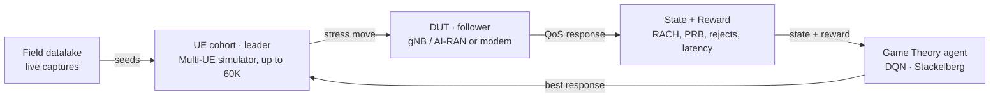

# Anritsu AI-RAN Test Arena — Product Requirements Document

*29 Oct 2026 · Marsh Dsouza*

## 1. Vision

Test Arena turns AI-RAN and modem testing into an endless, adversarial game. An AI-trained UE cohort plays against the device under test (DUT) until the DUT breaks or the engineer calls time.

**The problem.** Today's protocol and RF test suites are scripted, static and written by hand. They prove conformance but rarely find the edge cases a live 6G network will throw at a gNB or modem: signalling storms, retry loops, and mixed URLLC/eMBB/mMTC contention. Field data that could reveal those cases sits unused in the datalake.

**The product.** Test Arena is a web application that sits on top of Anritsu's Multi-UE simulator (up to 60K UEs). An engineer picks a feature and a difficulty level, and the platform generates testcases from live field captures and launches them as a "game". A Game Theory agent (DQN, Stackelberg leader–follower) learns which sequences push the DUT hardest, scores the DUT's QoS response, and escalates.

**The game loop.**

1. **Leader (UE cohort)** chooses an attack move: RACH burst, access-retry loop, small-packet flood, or GBR throughput demand.
2. **Follower (DUT)** responds with barring, admission, scheduling or rejects.
3. **State** (RACH, PRB use, rejects) and **Reward** (reject, latency, drop) feed the agent.
4. **Agent** computes its best response and escalates. The loop never ends on its own.

Field captures seed the cohort. Every DUT response becomes the agent's next state and reward, so the loop only ends on Stop or failure.

**Why it matters.** Anritsu moves from selling test equipment to selling *discovered failure modes*. R&D teams find breaking points in days rather than in field trials. Every run makes the agent and the testcase library smarter.

**One-line pitch:** *Don't write tests. Play the network until it breaks.*

## 2. User Personas

Three people use Test Arena daily. Priya is the primary design target.

### Priya — gNB / AI-RAN Protocol Test Engineer (primary)

- **Works at:** a Tier-1 RAN vendor's 6G lab, where she owns L2/L3 and RRM verification for an AI-RAN scheduler.
- **Goal:** find where the AI scheduler breaks under mixed URLLC/eMBB/mMTC load, before the operator does.
- **Pain today:** she spends 60% of her week writing and maintaining TTCN/Python scripts that only test what she already thought of.
- **Needs from Test Arena:** to pick "RACH storm, Hard", hit Play and leave it running overnight, then come back to a ranked list of failures with full logs.
- **Success for her:** "It found a bug I would never have scripted."

### Kenji — Modem Firmware & RF Engineer

- **Works at:** a chipset/modem maker, validating 5G-Advanced/6G modem firmware on the RF and protocol side.
- **Goal:** stress the modem's protocol stack and RF front-end against realistic, hostile network behaviour.
- **Pain today:** network emulator scenarios are idealised, and real-network quirks only appear in expensive drive tests.
- **Needs from Test Arena:** to flip the game so the *network* becomes the adversary, replaying field-captured operator behaviour (e.g. a specific MNO's configuration) against his modem.
- **Success for him:** reproducing a field-reported crash in the lab within an hour.

### Sofia — Test Automation Lead / Programme Manager

- **Works at:** a mobile operator's or vendor's integration lab, where she runs a team of 8 engineers and the CI pipeline.
- **Goal:** hyper-automated, lights-out regression with clear evidence for release go/no-go decisions.
- **Pain today:** test results live in scattered logs, and no single score shows whether a software drop is stronger or weaker than the last.
- **Needs from Test Arena:** API/CI triggers, a leaderboard of DUT builds by resilience score, and exportable reports for management.
- **Success for her:** every nightly build gets a resilience score with no human in the loop.

## 3. Feature List

The scope assumes one developer working with AI coding agents. The Must-Haves form a demoable MVP in roughly 10–12 weeks. Hardware integration starts as a simulated adapter, so the UI and game engine never wait on lab access.

### Must-Have (MVP)

| # | Feature | What it does | Maps to |
| --- | --- | --- | --- |
| M1 | Game Lobby | Pick target (gNB or modem), feature under test (RACH, mobility, scheduling, GBR, power/RF), and difficulty (Easy / Normal / Hard / Brutal). | Vibe 1 |
| M2 | Testcase generator | Builds a testcase sequence from datalake field captures filtered by feature and difficulty, and shows the source captures used. | Vibe 1, live data |
| M3 | Endless game loop | Runs continuously and stops only on user Stop or a defined DUT failure (crash, KPI breach, assert). | Vibe 2 |
| M4 | Game Theory engine v1 | Stackelberg leader–follower loop with a DQN agent choosing the next stress move from state + reward. | Vibe 6 |
| M5 | Built-in stress games (4) | Signalling Storm, Retry Loop, Small-Packet Flood, GBR Squeeze, each a preset game with tunable intensity. | Vibe 6 |
| M6 | Live arena view | Cohort grid (URLLC / eMBB / mMTC), DUT status, State → Reward → Action panel, live QoS score. | Vibe 1 |
| M7 | Built-in diagnostics | Live KPI strip (RACH success, PRB util, rejects, latency, drops). On failure, auto-captures the last N seconds of logs + game state. | Vibe 3 |
| M8 | Instrument adapter layer | One interface to the Multi-UE simulator; ships with a mock adapter for development and demos. | Platform |
| M9 | Run history | Every game saved with config, score timeline, failure point and replay of the move sequence. | Diagnostics |

### Should-Have (v1.1)

| # | Feature | What it does | Maps to |
| --- | --- | --- | --- |
| S1 | Hot-add games | While a game runs, prompts the user to stack another feature ("DUT survived 30 min — add Mobility Storm?"). Games run concurrently. | Vibe 2 |
| S2 | Vendor & operator profiles | Import RAN vendor parameter sets and MNO network models (JSON/YAML). The agent adapts its strategy per profile. | Vibe 5 |
| S3 | Automation API + CI hooks | REST/WebSocket API to start, stop and query games; webhooks on failure; Jenkins/GitLab examples. | Vibe 4 |
| S4 | Failure root-cause hints | AI summary of the failure: the move sequence that triggered it, the KPIs that drifted first, and the likely layer. | Vibe 3 |
| S5 | Reverse mode (modem) | The network becomes the adversary for modem testing, replaying operator behaviour against the modem. | Persona Kenji |
| S6 | Resilience leaderboard | Ranks DUT builds by resilience score and shows the trend across software drops. | Persona Sofia |
| S7 | Scheduled campaigns | Queue games overnight with a stop budget (time, failures). | Vibe 4 |

### Nice-to-Have (later)

| # | Feature | What it does |
| --- | --- | --- |
| N1 | Game designer | No-code editor to compose new stress games from move primitives. |
| N2 | Agent library | Swap algorithms (PPO, multi-agent, Nash equilibrium search) and compare which breaks the DUT fastest. |
| N3 | Testcase export | Export winning attack sequences as reusable conformance-style scripts. |
| N4 | Achievements & streaks | Badges such as "First Blood" (first DUT failure) and "Iron DUT" (24 h with no failure). |
| N5 | Digital Twin hook | Run games against a network digital twin before touching real hardware. |
| N6 | Multi-user arena | Shared live view, comments on failure moments, team spectator mode. |
| N7 | NTN / RF impairment games | Doppler, delay and fading stress for non-terrestrial and RF front-end testing. |

## 4. Technical Constraints

The browser shows and steers the game. The real-time work happens server-side, next to the instruments.

### Hard limits

- **Real-time split.** Slot-level decisions (sub-ms) run on the simulator/agent host, never in the browser. The UI receives state at 10–20 Hz over WebSocket.
- **Scale.** The UI must represent cohorts of up to 60K UEs. It renders aggregated cohort tiles, not one element per UE.
- **Instrument interfaces.** All hardware access goes through the adapter layer over Anritsu's standard interfaces (Ethernet/SCPI, GPIB, USB). There are no vendor-specific calls outside the adapter.
- **Datalake access is read-only.** Testcase generation queries field captures but never writes back to or modifies them.
- **Data confidentiality.** Field captures and vendor/MNO profiles are customer-confidential. This requires on-premise or private-cloud deployment, no third-party telemetry, and masking of subscriber identifiers (IMSI/SUPI) before display.
- **Deterministic replay.** Every game logs its seed, agent version and move sequence, so any failure can be replayed exactly.
- **Solo-dev stack.**
  - Backend and game engine: Python (FastAPI).
  - Agent: PyTorch.
  - Front-end: TypeScript/React.
  - Storage: PostgreSQL + a time-series store for KPIs.
  - Deployment: Docker Compose.
  - Choose boring, well-documented libraries that AI agents generate reliably.
- **Standards.** Testcase vocabulary aligns with 3GPP terms (RACH, RRC, PRB, 5QI/GBR). O-RAN interfaces (E2/A1) are a target for AI-RAN DUTs.

### Explicit non-goals (v1)

- Not a 3GPP conformance or certification tool. Test Arena finds breaking points; it does not issue pass/fail certificates.
- No in-browser signal processing or RF analysis.
- No public SaaS / multi-tenant cloud.
- No mobile app. Desktop browsers on lab workstations only (1920×1080 minimum).
- No training of large foundation models. The agent is a compact RL model trained per feature.
- No support for non-Anritsu simulators in v1.

## 5. Design Standard

**Direction: "Arcade Mission Control"**, a retro arcade cabinet bolted onto a professional test bench. The game layer makes engineers want to keep playing; the instrument layer makes them trust every number.

Rule of thumb: *arcade on the surface, oscilloscope underneath.* Pixel styling is for moments (score, game start, DUT failure). Data is always crisp and readable.

### Colour

Dark only. Every colour carries one meaning and keeps it everywhere.

| Token | Hex | Meaning |
| --- | --- | --- |
| `bg-void` | #05070A | App background (near-black CRT) |
| `bg-panel` | #0B1015 | Panels and cards |
| `line-arena` | #39FF6A | Arena frame, Network/DUT, "running" state |
| `ue-urllc` | #FF4FD8 | URLLC UEs |
| `ue-embb` | #3FD4FF | eMBB UEs |
| `ue-mmtc` | #FFB23F | mMTC UEs |
| `agent` | #8B7BFF | DQN / Game Theory agent, AI actions |
| `score` | #FFE14D | Reward and score only |
| `fail` | #FF3B3B | DUT failure, critical alerts only |
| `text-hi` / `text-lo` | #E6EDF3 / #7D8A99 | Body text / labels |

- Neon colours are for lines, glyphs and text, never large filled areas.
- Red appears only when the DUT fails, so it feels like an event.
- Anritsu brand green sits in the top bar and reports. The arena uses the neon palette.

### Typography

| Use | Font | Rules |
| --- | --- | --- |
| Arcade display (score, game titles, "PLAY 042", "DUT DOWN") | Press Start 2P | Uppercase, ≤ 3 words, never for body text or data |
| UI and body | Inter | 14 px base, 1.5 line height |
| Data, KPIs, logs, IDs | JetBrains Mono | Tabular numerals, right-aligned in tables |

### Texture and atmosphere

- 1 px panel borders with a soft outer glow (`box-shadow 0 0 8px` in the border colour at 40%).
- A faint scanline overlay (3% opacity) on the arena canvas only, never over logs or tables.
- Pixel-sprite icons for UEs and the gNB tower, as in the concept image; standard line icons elsewhere.
- Labelled flow arrows between the STATE → REWARD → ACTION → AGENT panels, always visible while a game runs.

### Layout

- Three zones: **Arena** (left, ~60%) · **Agent loop** (right) · **Diagnostics strip** (bottom, always visible).
- A legend bar pinned under the arena: URLLC · eMBB · mMTC · NETWORK.
- Engineering density: no empty hero areas. Every pixel shows either game state or a KPI.

### Motion and feedback

- The arena is always alive while running. UE sprites pulse with traffic, RACH attempts animate upward, and barring shows as a dashed wall.
- The score counts up with a short tick on every reward update. Difficulty escalation flashes the frame once.
- DUT failure is the "game over" moment. The arena freezes, the frame turns red, a "DUT DOWN" banner appears and the diagnostics snapshot slides up.
- The hot-add prompt appears as an arcade "CONTINUE?" card. It is dismissable and never blocking.
- Respect `prefers-reduced-motion`: keep state changes, drop pulses and scanlines.

### Accessibility and trust

- Never rely on colour alone. UE types also differ by sprite shape and label.
- Text contrast is ≥ 4.5:1 against `bg-panel`.
- Every number on screen has a unit and can be exported.

## 6. Success Criteria

The MVP is done when an engineer can go from lobby to a running stress game in under 60 seconds and the agent measurably out-breaks a scripted test.

### MVP definition of done

| Area | Measure | Target |
| --- | --- | --- |
| Speed to play | Lobby → game running | < 60 s, ≤ 4 clicks |
| Generation | Testcase generated from datalake captures | < 2 s per testcase |
| Endless loop | Unattended run without platform crash | ≥ 24 h on mock adapter, ≥ 8 h on real simulator |
| Stop conditions | Game halts on user Stop or DUT failure | 100% of cases, within 1 s |
| Diagnostics | Failures with auto-captured logs + game state | 100% of failures |
| Replay | Failure reproduced from saved seed and move log | ≥ 95% of failures |
| UI responsiveness | Arena update rate at 60K-UE cohort | ≥ 10 fps, no dropped state |
| Agent value | Time to first DUT failure vs. scripted stress baseline | ≥ 30% faster on a reference DUT |
| Stress games | Built-in games playable end to end | 4 of 4 |

### v1.1 and adoption

- **Hot-add:** a second game is added to a running session with no restart.
- **Automation:** a full game run is triggered and reported via API from a CI pipeline, with zero manual steps.
- **Profiles:** at least 2 RAN vendor and 2 MNO profiles are imported and change agent behaviour.
- **Pilot:** 3 internal or customer engineers each run ≥ 5 games in a week, and at least one reports a defect not found by their existing suite.
- **Usability:** pilot users rate "I wanted to keep playing" ≥ 4/5.

### Open questions

- Which reference DUT sets the agent-value baseline: a commercial gNB, an O-RAN stack such as OAI/srsRAN, or a modem?
- What counts as "DUT failure" per feature: crash only, or KPI breach thresholds? This needs a table per game.
- What are the datalake schema and access path for field captures? To confirm with the data team.
