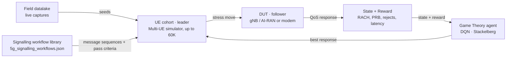

# Anritsu AI-RAN Test Arena — Product Requirements Document

*v1.5 · 4 Nov 2026 · Marsh Dsouza*

> **Change log**
> - **v1.5 (4 Nov 2026):** Moved to **workflow library v3** (schema 3.0.0): every NAS message is its own step, decoded IE by IE from a new NAS library (92 PDUs, TS 24.501 clause, security header, protected PDU, TS 24.301 equivalent); five new workflows (WF-13 initial registration + PDU sessions, WF-14 de-registration, WF-15 periodic registration, WF-16 PDU session release and 5GSM/5GMM errors, WF-17 5GS–EPS interworking); 5GS↔EPS timer and interworking tables. Branch sets updated: L1 19, L2 14, L3 12, L5 15. L1's baseline is now a real library flow.
> - **v1.4 (3 Nov 2026):** Moved to **workflow library v2** (schema 2.0.0): every flow now carries PHY and MAC steps (DCI grants, PRACH/RAR, Msg3/Msg4, SR, HARQ-ACK/NACK and retransmissions, MAC PDUs) with SFN/slot timing; RRC messages are full TS 38.331 Rel-18 ASN.1 (UPER-encoded, every absent IE listed) in a shared message library; NAS PDUs are encoded and ride inside their RRC containers. Failure workflows are now organised as cases. Branch mapping, stress-move slices, the trace and the verification list updated to match.
> - **v1.3 (2 Nov 2026):** Added the **signalling trace** to diagnostics (M7): every message the cohort sends and every DUT response, decoded to IE level from the workflow library, with a verdict on each DUT response. Stress moves now replay workflow slices, with random access (Msg1/Msg2) ahead of RACH moves.
> - **v1.2 (2 Nov 2026):** Games are now driven by the **5G signalling workflow library** (`5g_signalling_workflows.json`, 12 workflows, 3GPP-baselined). Every ladder branch and stress move traces to a workflow ID. Added Level 5 (IMS Voice & Video), new feature M11, workflow mapping (§3), three-cell emulation, and new success criteria and open questions.
> - **v1.1 (2 Nov 2026):** Added the **Procedure Ladder**, four game-theory levels for core mobile procedures (Registration → Data Call → Handover → Throughput). New features M10, S8 and N8; new game catalogue (§3); new success criteria and open questions (§6).
> - **v1.0 (29 Oct 2026):** First release.

## 1. Vision

Test Arena turns AI-RAN and modem testing into an endless, adversarial game. An AI-trained UE cohort plays against the device under test (DUT) until the DUT breaks or the engineer calls time.

**The problem.** Today's protocol and RF test suites are scripted, static and written by hand. They prove conformance but rarely find the edge cases a live 6G network will throw at a gNB or modem: signalling storms, retry loops, and mixed URLLC/eMBB/mMTC contention. Field data that could reveal those cases sits unused in the datalake.

**The product.** Test Arena is a web application that sits on top of Anritsu's Multi-UE simulator (up to 60K UEs). An engineer picks a feature and a difficulty level, and the platform generates testcases from live field captures and launches them as a "game". A Game Theory agent (DQN, Stackelberg leader–follower) learns which sequences push the DUT hardest, scores the DUT's QoS response, and escalates.

**Two ways to play.**

| Mode | What it is | Ends when |
| --- | --- | --- |
| **Stress games** | Four endless load games (Signalling Storm, Retry Loop, Small-Packet Flood, GBR Squeeze). The agent escalates until something breaks. | User Stop or DUT failure |
| **Procedure Ladder** *(v1.1, extended in v1.2)* | Five levels that test the core mobile procedures in the order a UE uses them: **Registration → Data Call → Handover & Mobility → Throughput → IMS Voice & Video**. Each level is modelled as a different kind of game, and a level unlocks only when the one before it is cleared. | Level clear, User Stop or DUT failure |

The ladder is the "basics first" path. A DUT that can't register correctly has no business being stress-tested, so engineers (and new users learning the tool) start at Level 1 and climb.

**Built on real signalling.** Moves are not invented. Each one replays a 3GPP signalling workflow from the **workflow library** (`5g_signalling_workflows.json`): the message sequence, the information elements, the timers and the expected UE behaviour, baselined on TS 38.508-1, 38.331, 24.501, 24.229 and 38.523-1. The game decides *which* workflow, failure case or reject cause to play next; the workflow decides *exactly what goes on the air* and what "correct" looks like. See §3, Signalling workflow library.

**The game loop.**

1. **Leader (UE cohort)** chooses an attack move: RACH burst, access-retry loop, small-packet flood, or GBR throughput demand. On the ladder, moves are the level's branch set (§3, Procedure Ladder catalogue). Every move is a workflow from the library (or a failure case, variant or reject cause within one), replayed across the cohort.
2. **Follower (DUT)** responds with barring, admission, scheduling or rejects.
3. **State** (RACH, PRB use, rejects) and **Reward** (reject, latency, drop) feed the agent.
4. **Agent** computes its best response and escalates. Stress games never end on their own; ladder levels end when the level is cleared.

Field captures seed the cohort and the workflow library supplies the moves. Every DUT response becomes the agent's next state and reward, so a stress game only ends on Stop or failure.

**Why it matters.** Anritsu moves from selling test equipment to selling *discovered failure modes*. R&D teams find breaking points in days rather than in field trials. Every run makes the agent and the testcase library smarter.

**One-line pitch:** *Don't write tests. Play the network until it breaks.*

## 2. User Personas

Three people use Test Arena daily. Priya is the primary design target.

### Priya — gNB / AI-RAN Protocol Test Engineer (primary)

- **Works at:** a Tier-1 RAN vendor's 6G lab, where she owns L2/L3 and RRM verification for an AI-RAN scheduler.
- **Goal:** find where the AI scheduler breaks under mixed URLLC/eMBB/mMTC load, before the operator does.
- **Pain today:** she spends 60% of her week writing and maintaining TTCN/Python scripts that only test what she already thought of.
- **Needs from Test Arena:** to pick "RACH storm, Hard", hit Play and leave it running overnight, then come back to a ranked list of failures with full logs. On a new software drop she first runs the Procedure Ladder to confirm the basics still hold.
- **Success for her:** "It found a bug I would never have scripted."

### Kenji — Modem Firmware & RF Engineer

- **Works at:** a chipset/modem maker, validating 5G-Advanced/6G modem firmware on the RF and protocol side.
- **Goal:** stress the modem's protocol stack and RF front-end against realistic, hostile network behaviour.
- **Pain today:** network emulator scenarios are idealised, and real-network quirks only appear in expensive drive tests.
- **Needs from Test Arena:** to flip the game so the *network* becomes the adversary, replaying field-captured operator behaviour (e.g. a specific MNO's configuration) against his modem. The ladder's off-path branches (reject causes, timer expiry, RRC reject, handover failure, IMS SIP errors) are exactly the cases his scripts miss, and each one traces to a 3GPP workflow and clause he already knows.
- **Success for him:** reproducing a field-reported crash in the lab within an hour.

### Sofia — Test Automation Lead / Programme Manager

- **Works at:** a mobile operator's or vendor's integration lab, where she runs a team of 8 engineers and the CI pipeline.
- **Goal:** hyper-automated, lights-out regression with clear evidence for release go/no-go decisions.
- **Pain today:** test results live in scattered logs, and no single score shows whether a software drop is stronger or weaker than the last.
- **Needs from Test Arena:** API/CI triggers, a leaderboard of DUT builds by resilience score, and exportable reports for management. "Highest ladder level cleared" is a simple first gate for every build.
- **Success for her:** every nightly build gets a resilience score with no human in the loop.

## 3. Feature List

The scope assumes one developer working with AI coding agents. The Must-Haves form a demoable MVP in roughly 14–16 weeks (v1.0 estimate plus ~2 weeks for the Procedure Ladder and ~2 weeks for the workflow library and Level 5). Hardware integration starts as a simulated adapter, so the UI and game engine never wait on lab access.

### Must-Have (MVP)

| # | Feature | What it does | Maps to |
| --- | --- | --- | --- |
| M1 | Game Lobby | Pick mode (Stress games or Procedure Ladder), target (gNB or modem), feature or ladder level, and difficulty (Easy / Normal / Hard / Brutal). | Vibe 1 |
| M2 | Testcase generator | Builds a testcase sequence from datalake field captures filtered by feature and difficulty, and shows the source captures used. For ladder levels it also lists the branch set and game model. | Vibe 1, live data |
| M3 | Endless game loop | Runs continuously and stops only on user Stop or a defined DUT failure (crash, KPI breach, assert). Ladder levels also end on Level Clear. | Vibe 2 |
| M4 | Game Theory engine v1 | Stackelberg leader–follower loop with a DQN agent choosing the next stress move from state + reward. On the ladder the agent chooses which branch to play next. | Vibe 6 |
| M5 | Built-in stress games (4) | Signalling Storm, Retry Loop, Small-Packet Flood, GBR Squeeze, each a preset game with tunable intensity. Each move scales up a library workflow (see the stress-game mapping in §3). | Vibe 6 |
| M6 | Live arena view | Cohort grid (URLLC / eMBB / mMTC), DUT status, State → Reward → Action panel, live QoS score. | Vibe 1 |
| M7 | Built-in diagnostics | Live KPI strip (five KPIs per game; see catalogue) and a **signalling trace**: a protocol-analyser view of every message the cohort sends and every DUT response, drawn as a UE ↔ gNB ↔ 5GC ↔ IMS ladder diagram, from PHY up: DCI grants, HARQ-ACK and SR, MAC PDUs, the full TS 38.331 ASN.1 of every RRC message (UPER hex and decoded IE tree, absent IEs listed), every NAS PDU decoded IE by IE (TS 24.501, with its security header and TS 24.301 equivalent) and SIP headers/SDP and a verdict on each DUT response (as expected, late, wrong message, no response). On failure, auto-captures the last N seconds of logs, game state and the trace, focused on the failing exchange. | Vibe 3 |
| M8 | Instrument adapter layer | One interface to the Multi-UE simulator; ships with a mock adapter for development and demos. | Platform |
| M9 | Run history | Every game saved with config, score timeline, failure point and replay of the move sequence. | Diagnostics |
| M10 | **Procedure Ladder (5 levels)** | Registration → Data Call → Handover & Mobility → Throughput → IMS Voice & Video. Each level has its own game model, branch set, five KPIs and clear rule. Levels unlock in order per DUT. | Vibe 1, Vibe 6 |
| M11 | **Signalling workflow library** | Loads `5g_signalling_workflows.json` (schema `test-arena.signalling-workflows` v3.0.0). Every ladder branch and stress move references a workflow ID (plus failure case, variant or cause). The Briefing shows each branch's message flow; the Arena narrates messages and timers as they play; reports name the workflow step where the DUT went wrong. | Vibe 1, Vibe 3 |

### Should-Have (v1.1)

| # | Feature | What it does | Maps to |
| --- | --- | --- | --- |
| S1 | Hot-add games | While a game runs, prompts the user to stack another feature ("DUT survived 30 min — add Mobility Storm?"). Games run concurrently. | Vibe 2 |
| S2 | Vendor & operator profiles | Import RAN vendor parameter sets and MNO network models (JSON/YAML). The agent adapts its strategy per profile. | Vibe 5 |
| S3 | Automation API + CI hooks | REST/WebSocket API to start, stop and query games; webhooks on failure; Jenkins/GitLab examples. | Vibe 4 |
| S4 | Failure root-cause hints | AI summary of the failure: the move sequence that triggered it, the KPIs that drifted first, and the likely layer. | Vibe 3 |
| S5 | Reverse mode (modem) | The network becomes the adversary for modem testing, replaying operator behaviour against the modem. | Persona Kenji |
| S6 | Resilience leaderboard | Ranks DUT builds by resilience score and highest ladder level cleared, and shows the trend across software drops. | Persona Sofia |
| S7 | Scheduled campaigns | Queue games overnight with a stop budget (time, failures). | Vibe 4 |
| S8 | **Tournament mode** | Chains all five ladder levels in one run with state carried across (registered UE → active PDU session → handover with data running → throughput after handover → VoNR call over the same bearers). Cross-workflow cases such as RLF during an active call (WF-03 + WF-12) are played here. Finds interaction bugs that pass in isolated levels. | Vibe 2 |

### Nice-to-Have (later)

| # | Feature | What it does |
| --- | --- | --- |
| N1 | Game designer | No-code editor to compose new stress games from move primitives. |
| N2 | Agent library | Swap algorithms (PPO, multi-agent, Nash equilibrium search) and compare which breaks the DUT fastest. |
| N3 | Testcase export | Export winning attack sequences as reusable conformance-style scripts. |
| N4 | Achievements & streaks | Badges such as "First Blood" (first DUT failure), "Iron DUT" (24 h with no failure) and "Ladder Master" (all five levels cleared on Brutal). |
| N5 | Digital Twin hook | Run games against a network digital twin before touching real hardware. |
| N6 | Multi-user arena | Shared live view, comments on failure moments, team spectator mode. |
| N7 | NTN / RF impairment games | Doppler, delay and fading stress for non-terrestrial and RF front-end testing. |
| N8 | **Mobility under load** (Ladder Level 6) | A repeated game where handovers happen during congestion, so the Level 3 and Level 4 rules must hold at the same time. |
| N9 | **Workflow authoring and import** | Add or edit workflows in the library schema, and import them from existing TTCN-3 / TS 38.523-1 test cases, so customers can bring their own procedures into the game. |

### Signalling workflow library

The library file `5g_signalling_workflows.json` is the single source of truth for what every move sends and what counts as correct.

- **Schema:** `test-arena.signalling-workflows` v3.0.0 · technology 5G NR SA (5GS), FR1 TDD · generated 3 Nov 2026 · 17 workflows, 29 cases, 1,927 steps.
- **Spec baseline:** RRC ASN.1 TS 38.331 Rel-18 (UPER-encoded and decoded back); default message contents TS 38.508-1; DCI TS 38.212 7.3.1; MAC TS 38.321; PHY procedures TS 38.213/38.214/38.211; NAS TS 24.501 (every PDU hand-encoded and round-tripped); EPS NAS TS 24.301 for interworking; IMS TS 24.229 with TS 34.229-1/-5.
- **Test environment defaults:** band n78, TDD, 30 kHz SCS, 40 MHz BWP, pattern DDDDDDDSUU; PLMN 001/01; Cells 1 and 2 in TAC 1, Cell 3 in TAC 2; reference UE identities (IMSI, 5G-S-TMSI, C-RNTI); DCI sizes, HARQ timing (K1, K2), SR config, radio bearers (SRB1–2, DRB1–4) and RRC procedure delays.
- **Step model:** each step has `seq`, `time` (SFN, slot, ms), `dir` (UL, DL, UE-internal, SS test-system action), `layer` (PHY, MAC, RRC, 5GMM, 5GSM, EMM, SIP), `channel` and `message`, plus whichever applies: `pdcch` (DCI format, RNTI, search space, CORESET, aggregation level and every field with bit width and value), `pdsch`/`pusch`, `pucch` (HARQ-ACK or SR), `prach`, `macPdu`, `messageRef` (RRC, into the message library), `carriesNAS` (on RRC steps), SIP `headers`/`sdp`, `timers` (start, stop, expired, running), `note` and `expect`.
- **NAS steps:** every NAS message is its own step (5GMM; 5GSM inside UL/DL NAS TRANSPORT; EMM for TS 24.301) with `nasMessageRef` into the NAS library, `carriedIn` (RRC message, field, and the NAS TRANSPORT payload container for 5GSM), `security` (security header type, MAC placeholder, sequence number, NAS COUNT, protected hex as carried), `procedure`, `summary` and `eps24301Equivalent`. UL NAS appears just before its RRC container; DL NAS just after.
- **Message libraries:** 107 RRC messages (ASN.1 type, UPER hex, decoded IE tree with `_absentOptional`/`_absentExtensions` at every level, contained CellGroupConfig/NAS) and 92 NAS PDUs (TS 24.501 clause, procedure, TS 24.301 equivalent, plain hex, IEs with IEI/length/value, absent optional IEs, contained messages).
- **Interworking references:** `nasInterworking24301` (10 places where EPS IEs ride in 5GS NAS, e.g. S1 UE network capability, selected EPS NAS algorithms, mapped EPS bearer contexts), `nasTimers` (14 timers with defaults, start/stop and their TS 24.301 equivalents, e.g. T3510 ↔ T3410/T3430) and `guti4G5GMapping` (TS 23.003 2.10.2).
- **Outcome model:** success workflows have `passCriteria`; failure workflows have `cases` (each a full step list), some with a `causeMatrix` (cause, encoded NAS PDU, expected UE behaviour) or `sipResponseMatrix`; `variants` describe changes to a base flow.
- **Verification list:** `defaults.verify` names 10 configuration areas (band/ARFCN, TDD pattern, CORESET#0, PRACH, SR and HARQ timing, TDRA tables, RLC/PDCP timers, logical-channel priorities, SIB1 UE timers, A3 and cell power) to check against the customer's TS 38.508-1 baseline.
- **Not covered yet** (`notCoveredYet`): UE-requested PDU session modification, EAP-AKA′, NSSAA, SOR/UE parameters update; MT voice/video, IMS registration and emergency, SMS; RRC_INACTIVE, release with redirect, UAC barring; CHO, DAPS, inter-frequency HO with gaps; CA, BWP switching, standalone BFR, on-demand SI; ETWS/CMAS, positioning, NR-DC, RedCap, NTN. The LTE RRC and L1 side of EPS fallback arrives with the LTE stage.

#### The 17 workflows and where they play

| ID | Workflow | Category | Plays in |
| --- | --- | --- | --- |
| WF-01 | MO Data Call | data · success | L2 baseline; Signalling Storm, Small-Packet Flood, GBR Squeeze |
| WF-02 | MT Data Call (paging) | data · success | L2; Signalling Storm (paging flood), Small-Packet Flood |
| WF-03 | IMS Voice Call (VoNR, MO) | ims-voice · success | L5 baseline; GBR Squeeze |
| WF-04 | IMS Video Call (ViNR, MO) | ims-video · success | L5 |
| WF-05 | Intra-frequency handover (+ variant b, new TA) | mobility-connected · success | L3 baseline |
| WF-06 | Cell reselection in RRC_IDLE (cases a same TA, b new TA + mobility registration) | mobility-idle · success | L3 |
| WF-07 | Registration failure (cases a REJECT with 9-cause matrix, b auth failure #20 + AUTHENTICATION REJECT, c NAS SMC reject #23, d no response/T3510) | failure-registration | L1; Retry Loop |
| WF-08 | MO data call failure (cases a–e, SERVICE REJECT cause matrix) | failure-data | L2; Retry Loop |
| WF-09 | IMS voice call failure (cases a 486 with response matrix [480/503/408, no final response, IMS-VoPS=0], b no 5QI 1 flow, c QoS rule rejected #83) | failure-ims-voice | L5 |
| WF-10 | IMS video call failure (cases a 488, b video port 0, c video DRB configuration failure) | failure-ims-video | L5 |
| WF-11 | Handover failure, T304 expiry (+ variant b, re-establishment fails on T311) | failure-mobility | L3 |
| WF-12 | Radio link failure (+ variant e, no recovery) | failure-radio | L3; L5 "RLF during an active call" |
| WF-13 | Initial registration + PDU session establishment (cases a internet + IMS sessions and configuration update, b with identification, c IMS PDU session reject #27) | registration · success | L1 baseline and identification; L2 PDU session reject; Retry Loop |
| WF-14 | De-registration (cases a UE switch-off, b UE normal, c network-initiated with re-registration) | deregistration · success | L1 |
| WF-15 | Periodic registration update (T3512) | registration · success | L1 |
| WF-16 | PDU session release and 5GSM/5GMM error handling (cases a UE release, b network release #39 + re-establishment, c 5GSM STATUS, d 5GMM STATUS) | session-management · success | L2 |
| WF-17 | 5GS–EPS interworking, TS 24.301 linkage (cases a EPS → 5GS idle mobility, b EPS fallback for IMS voice with 24.301 TAU) | interworking · success | L3 (a), L5 (b) |

#### How a workflow becomes a move

1. **Pick.** The agent picks a branch, which names a workflow and optionally a case, a matrix row or a variant (for example `WF-07a · #22`).
2. **Replay.** The adapter replays the steps in order, PHY to SIP; each NAS PDU is its own step next to the RRC message that carries it. The branch's injection step is where the game deviates from the happy path: an `SS` action (cell power change, withheld response), a cause-matrix row (the REJECT's NAS PDU is replaced by the matrix encoding), a SIP response-matrix row, or a variant note.
3. **Fan out.** Workflows describe one UE. The cohort plays the same branch across many UEs with staggered start times, so per-UE outcomes become the level's KPIs (success %, latency, rejects, timeouts).
4. **Judge.** The branch passes only if the DUT meets the workflow's `passCriteria` or the matching `expectedUE` (correct message, cause, timer start/stop, state). A wrong message, a missed timer or a hang is a branch failure; a crash or KPI breach is `DUT DOWN`.
5. **Record.** The run log keeps the workflow ID, case and the step reached, so a failure report reads "Failed at WF-11 step 4: no RRCReestablishmentRequest before T311 expiry".

#### Stress games and their workflow basis

| Stress game | Workflow basis | What is scaled up |
| --- | --- | --- |
| Signalling Storm | WF-01 steps 8–16 (Msg1 → Msg4 HARQ-ACK), 8–22 (to RRCSetupComplete carrying SERVICE REQUEST); WF-02 steps 1–18 (paging → RRCSetupComplete) | Random-access and RRC setup bursts, paging floods |
| Retry Loop | WF-08a, WF-08b, WF-07a (#22 + T3346), WF-13a (re-attach) | UEs that ignore RRCReject wait time, missing Msg4/T300 and T3346 back-off |
| Small-Packet Flood | WF-01 steps 42–58 (SR → grant → PUSCH, CRC fail and retransmission), 42–45, 8–45; WF-02 | SR storms and short UL bursts from mMTC UEs |
| GBR Squeeze | WF-03 steps 43–61 (PDU SESSION MODIFICATION for 5QI 1 to COMPLETE), 1–61; WF-01 steps 46–51 (DL data with NACK and retransmission) | Dedicated 5QI 1 QoS flows until admission and PRBs run out |

Random access, scheduling requests and HARQ are now in the library itself, so stress moves replay them exactly as listed.

#### Signalling trace and DUT response

- **Who is the DUT.** For a gNB target, the gNB is the DUT: its DL RRC/MAC/PHY messages are DUT responses; the UE is simulated and the 5GC and IMS are emulated. For a modem target, the UE is the DUT and everything it sends is a DUT response.
- **What each entry shows.** Time, sender and receiver lanes, layer, channel, container, SFN/slot, workflow and step, timers, the representative UE (index, slice, C-RNTI, masked 5G-S-TMSI, cell) and the full decode: DCI fields, PDSCH/PUSCH/PUCCH/PRACH parameters, MAC PDU, RRC ASN.1 (UPER hex, IE tree, absent IEs, contained CellGroupConfig/NAS, and which NAS messages it carries), NAS PDU (TS 24.501 clause, procedure, IE table with IEI/length/value, absent optional IEs, contained messages, security header with the protected PDU as carried, TS 24.301 equivalent), SIP headers and SDP. A PHY · MAC filter hides transport steps to leave the signalling.
- **gNB-internal steps.** "gNB decodes PUSCH: CRC OK/fail" is the gNB's own HARQ decision, so for a gNB target it is a DUT response. NR has no PHICH: UL ACK/NACK shows as NDI toggling in the next grant.
- **Identity masking.** The reference UE's IMSI/SUPI is masked to its last 4 digits everywhere it appears, including SIP URIs and the BCD digits inside NAS hex.
- **Latency.** A DUT response's latency is the library's own SFN/slot gap to the previous step, stretched by the current load; under barring or rejecting it is 3× that.
- **A verdict on every DUT response.** *As expected* (the message the workflow expects, with its latency), *late* (correct but slower than unloaded, e.g. while barring access), *wrong message* (e.g. RRCReject instead of RRCSetup) or *no response* (timer expiry, or the DUT going down).
- **Effect on the game.** On the ladder, a wrong or missing DUT response means the branch must replay cleanly before it can pass. In stress games that UE's flow is abandoned and the next UE starts.

### Procedure Ladder — game catalogue

Every level is a two-player game: the **Tester** (agent + UE cohort) tries to make the DUT misbehave, and the **DUT** wins a branch only if it behaves as the workflow says it should. Each level uses a different game-theory model, which decides how the agent explores.

| Level | Procedure | Game model | Workflows | What the model tells the tester |
| --- | --- | --- | --- | --- |
| 1 | Registration ("The Handshake") | **Sequential (extensive-form) game**, solved by backward induction | WF-07 | The DUT must be correct at *every* node of the procedure tree, including off-path branches (subgame perfection). The happy path alone proves little. |
| 2 | Data Call ("The Agreement") | **Coordination game** | WF-01, WF-02, WF-08 | UE and network must agree to bring up service. Test the miscoordination cells (reject, no response, partial accept), not just the agreed one. |
| 3 | Handover & Mobility ("Leader and Follower") | **Stackelberg game** | WF-05, WF-06, WF-11, WF-12 | The network leads by setting measurement and trigger parameters; the UE follows. The tester plays a "bad leader" and breaks the handover to test recovery. |
| 4 | Throughput ("Sharing the Pie") | **Congestion game + Nash bargaining**; link adaptation as a game against Nature | WF-01 (bearer set-up only) | Users compete for PRBs. Proportional-fair scheduling corresponds to the Nash Bargaining Solution, so fairness and efficiency are both measured. |
| 5 | IMS Voice & Video ("The Negotiation") | **Alternating-offers bargaining** (Rubinstein) | WF-03, WF-04, WF-09, WF-10 | SIP/SDP offer–answer and QoS preconditions are a sequence of offers and counter-offers. The tester rejects, counters or stalls to see whether the DUT settles, falls back or releases resources cleanly. |

Branch tables list the order the branches are played in; the first row is always the baseline. Easy plays the first four rows.

#### Level 1 — Registration

- **Procedure tree:** RRC setup → REGISTRATION REQUEST (T3510 started) → [IDENTITY REQUEST/RESPONSE] → AUTHENTICATION → NAS SECURITY MODE → AS security, UE capability → REGISTRATION ACCEPT (T3510 stopped) / REJECT → REGISTRATION COMPLETE → PDU sessions (internet, IMS) → CONFIGURATION UPDATE; plus periodic registration and de-registration. Source: WF-07, WF-13, WF-14, WF-15; TS 24.501 5.5.1, 5.5.2, 5.4; TS 38.523-1 9.1.5.

| # | Branch | Workflow | Correct DUT behaviour (from the library) |
| --- | --- | --- | --- |
| 1 | Initial registration + PDU sessions (baseline) | WF-13a | Cleartext REGISTRATION REQUEST, full message in the SECURITY MODE COMPLETE container; SHT 3/4 then 2; internet and IMS PDU sessions with mapped EPS bearer contexts; configuration update completed |
| 2 | REJECT #3 Illegal UE | WF-07a cause matrix | USIM invalid for 5GS; delete 5G-GUTI, TAI list, ngKSI; 5GMM-DEREGISTERED |
| 3 | REJECT #7 5GS services not allowed | WF-07a cause matrix | USIM invalid for 5GS services |
| 4 | REJECT #11 PLMN not allowed | WF-07a cause matrix | Forbidden PLMN list; PLMN selection |
| 5 | REJECT #12 Tracking area not allowed | WF-07a cause matrix | Forbidden TAs for regional provision of service; LIMITED-SERVICE |
| 6 | REJECT #13 Roaming not allowed in this TA | WF-07a cause matrix | Forbidden TAs for roaming; PLMN selection |
| 7 | REJECT #15 No suitable cells in TA | WF-07a cause matrix | Forbidden TAs for roaming; search another TA |
| 8 | REJECT #22 Congestion + T3346 | WF-07a cause matrix | Start T3346; no new attempt until expiry |
| 9 | REJECT #27 N1 mode not allowed | WF-07a cause matrix | Disable N1 mode; select E-UTRA/EPS (24.301 attach) |
| 10 | REJECT #62 No network slices available | WF-07a cause matrix | Store rejected NSSAI |
| 11 | No response (T3510) | WF-07d | Retry after T3511; after 5 attempts start T3502 |
| 12 | Authentication MAC failure (#20) | WF-07b | AUTHENTICATION FAILURE #20 (T3520); accepts AUTHENTICATION REJECT |
| 13 | Authentication synch failure (#21 + AUTS) | WF-07b, adapted | AUTHENTICATION FAILURE #21 with AUTS *(library shows #20; the cause octet is changed, AUTS is a placeholder, and the flow stops after the failure)* |
| 14 | NAS SMC rejected (#23) | WF-07c | SECURITY MODE REJECT #23 on mismatched replayed capabilities |
| 15 | Identification procedure | WF-13b | IDENTITY RESPONSE with SUCI, then registration completes |
| 16 | Periodic registration (T3512 expiry) | WF-15 | REGISTRATION REQUEST type periodic; REGISTRATION ACCEPT stops T3510 |
| 17 | De-registration, switch off | WF-14a | DEREGISTRATION REQUEST (switch off); no accept expected |
| 18 | De-registration, normal | WF-14b | T3521 started; stopped on DEREGISTRATION ACCEPT |
| 19 | Network de-registration, re-registration required | WF-14c | DEREGISTRATION ACCEPT, then a new initial registration |

- **KPIs (5):** Registration success (%), Registration latency (ms), Retries (/s), Rejects (/s), Procedure timeouts (/s).

#### Level 2 — Data Call

- **Procedure:** service request from 5GMM-REGISTERED/RRC_IDLE to an active user plane on PDU session 1 (QFI 1). Source: WF-01, WF-02, WF-08; TS 24.501 5.6.1, TS 38.331 5.3.3.
- **Prerequisite:** Level 1 cleared for this DUT.

| # | Branch | Workflow | Correct DUT behaviour |
| --- | --- | --- | --- |
| 1 | MO data call (baseline) | WF-01 | RRC cause mo-Data; service accepted, T3517 stopped; DRB1 carries data on QFI 1 |
| 2 | MT data call via paging | WF-02 | Responds to paging with mt-Access; service type "mobile terminated services"; DL data received |
| 3 | RRC connection rejected (wait time + T302) | WF-08a | No new mo-Data RRCSetupRequest until T302 expires |
| 4 | No Msg4, T300 expiry | WF-08b | Contention resolution fails, RA re-attempted; on T300 expiry NAS is informed and the service request aborted |
| 5 | SERVICE REJECT #9 / #10 | WF-08c cause matrix | Deregister, delete 5G-GUTI as required, initial registration |
| 6 | SERVICE REJECT #22 + T3346 | WF-08c cause matrix | Start T3346; no service request until expiry |
| 7 | SERVICE REJECT #28 / #7 | WF-08c cause matrix | Restricted area: NON-ALLOWED-SERVICE and mobility registration; #7: USIM invalid for 5GS |
| 8 | Service request no response (T3517) | WF-08d | Abort after T3517 (15 s); release NAS connection locally; back to 5GMM-REGISTERED |
| 9 | PDU session reactivation failure (#92) | WF-08e | Stop T3517; no user data on PSI 1; retry later |
| 10 | IMS PDU session establishment reject (#27) | WF-13c | Stop T3580; keep the internet session; no immediate retry with the same DNN |
| 11 | UE-requested PDU session release | WF-16a | T3582 started and stopped; RELEASE COMPLETE; mapped EPS bearer removed |
| 12 | Network release (#39) and re-establishment | WF-16b | RELEASE COMPLETE, then a new PDU SESSION ESTABLISHMENT REQUEST |
| 13 | 5GSM STATUS on PTI mismatch | WF-16c | Answers an invalid PTI with 5GSM STATUS #47 |
| 14 | 5GMM STATUS received | WF-16d | No state change |

- **Still parked:** UE-requested PDU session modification and the other PDU-session negotiation branches from v1.1 (IPv4v6 → IPv4 only, non-subscribed S-NSSAI, SSC mode, 5QI downgrade) until the library adds them.
- **KPIs (5):** Session setup success (%), Setup latency (ms), Fallbacks (/s), Session rejects (/s), Session drops (/s).

#### Level 3 — Handover & Mobility

- **Leader parameters:** the A3 measurement config from the library defaults (`MeasConfig_A3`: a3-Offset 3 dB, hysteresis 0, TTT 0 ms, all `verify`). The tester re-tunes them to play a "bad leader".
- **Prerequisite:** Level 2 cleared. Needs three emulated cells: Cells 1 and 2 in TAC 000001, Cell 3 in TAC 000002.

| # | Branch | Workflow | Correct DUT behaviour |
| --- | --- | --- | --- |
| 1 | Intra-frequency handover (baseline) | WF-05 | MeasurementReport on A3; CFRA and RRCReconfigurationComplete before T304 |
| 2 | Too-early trigger (bad leader: low offset) | WF-05 + A3 re-tune | Hands over without a drop or immediate return |
| 3 | Too-late trigger (bad leader: high offset, long TTT) | WF-05 + A3 re-tune | Recovers before RLF, or re-establishes per WF-12 |
| 4 | Ping-pong (bad leader: zero hysteresis, short TTT) | WF-05 + A3 re-tune | Avoids bouncing between Cell 1 and Cell 2 |
| 5 | Handover into a new TA | WF-05 variant b | Hands over to Cell 3, then mobility registration updating |
| 6 | Idle-mode reselection | WF-06a | Reselects to Cell 2 and answers paging there |
| 7 | Reselection into a new TA | WF-06b | Mobility registration updating with new TAI list |
| 8 | Handover failure (T304 expiry) | WF-11 | Target withholds the RAR; T304 expiry; T311; RRCReestablishmentRequest with cause handoverFailure |
| 9 | Re-establishment fails (T311 expiry) | WF-11 variant b | RRC_IDLE; 5GMM recovers with registration or SERVICE REQUEST |
| 10 | Radio link failure (T310 expiry) | WF-12 | Declares RLF at T310 expiry, re-establishes with otherFailure, RLF report correct |
| 11 | No recovery after RLF | WF-12 variant e | RRC_IDLE; mobility registration or SERVICE REQUEST on return |
| 12 | EPS → 5GS idle mobility | WF-17a | REGISTRATION REQUEST with mapped 5G-GUTI, UE status and EPS NAS message container; PDU sessions mapped from PDN connections |

- **Dropped with library v3** (no flow in the library any more): inter-frequency handover, priority-based reselection, re-establishment answered with RRCSetup, invalid reconfigurationWithSync, RLF from RLC max retransmissions or random-access problem, beam failure recovery.
- **KPIs (5):** HO success (%), Interruption time (ms), Ping-pong rate (%), RLF (/min), Session drops (/s).

#### Level 4 — Throughput

- **Bearer set-up:** WF-01 brings up DRB1 on QFI 1 before each branch. The library has no throughput workflows yet, so the branches below remain tester-defined.
- **Prerequisite:** Level 3 cleared.

| # | Branch | Correct DUT behaviour |
| --- | --- | --- |
| 1 | Single-UE peak (baseline) | Reaches peak throughput for one UE |
| 2 | Load ramp | Holds cell throughput as UEs are added |
| 3 | Mixed GBR priority | Serves GBR users without starving the rest |
| 4 | High-CQI hog | Keeps fairness when one strong UE pushes |
| 5 | Channel fade (Nature) | Picks the right MCS as SINR drops |

- **KPIs (5):** Cell throughput (Mbps), Per-UE throughput p5 (Mbps), Fairness (Jain's index, 0–1), BLER (%), PRB utilisation (%).

#### Level 5 — IMS Voice & Video *(new in v1.2)*

- **Procedure:** VoNR/ViNR MO call over IMS PDU session 2 (DNN ims, 5QI 5): service request, SIP INVITE, network-requested PDU SESSION MODIFICATION for dedicated QoS flows (5QI 1 voice, 5QI 2 video), 183/PRACK/UPDATE preconditions, 180/200/ACK, media, BYE and release. Source: WF-03, WF-04, WF-09, WF-10; TS 24.229, TS 34.229-1/-5, TS 26.114, TS 24.501 6.3.2.
- **Preconditions:** REGISTRATION ACCEPT indicates IMS VoPS = 1; IMS PDU session established; UE IMS-registered.
- **Prerequisite:** Level 4 cleared.

| # | Branch | Workflow | Correct DUT behaviour |
| --- | --- | --- | --- |
| 1 | VoNR MO call (baseline) | WF-03 | RRC cause mo-VoiceCall; PDU SESSION MODIFICATION adds 5QI 1 before 180/200; dialog set up and released cleanly |
| 2 | ViNR MO call | WF-04 | RRC cause mo-VideoCall; 5QI 1 and 5QI 2 flows with mapped EPS bearers; separate DRBs |
| 3 | Remote busy (486) | WF-09a | ACK; call cleared |
| 4 | Temporarily unavailable (480) | WF-09a response matrix, adapted | ACK; call cleared |
| 5 | Service unavailable (503) | WF-09a response matrix, adapted | ACK; call cleared |
| 6 | Request timeout (408) | WF-09a response matrix, adapted | ACK; call cleared |
| 7 | No final response (timer B) | WF-09a response matrix | P-CSCF failure handling; re-register |
| 8 | Dedicated QoS flow never set up | WF-09b | No UPDATE with curr:qos sendrecv; CANCEL, 487, ACK |
| 9 | UE rejects bad QoS rule | WF-09c | PDU SESSION MODIFICATION COMMAND REJECT #83; QoS flow not created |
| 10 | RLF during an active call | WF-03 steps 1–96 + WF-12 (composed) | Re-establishes and continues, or drops the call cleanly |
| 11 | IMS VoPS not supported | WF-09a response matrix | No VoNR origination; EPS fallback or CS per domain selection |
| 12 | EPS fallback for voice | WF-17b | Moves to E-UTRA; TS 24.301 TRACKING AREA UPDATE with active flag; PDU sessions map to PDN connections |
| 13 | Video codec not acceptable (488) | WF-10a | ACK; may retry voice-only |
| 14 | Video m-line rejected, audio accepted | WF-10b | Continues voice-only on QFI 2 |
| 15 | Video DRB cannot be configured | WF-10c | RRC re-establishment (reconfigurationFailure); video call fails |

- **Dropped with library v3** (WF-10a no longer has a response matrix): video QoS flow not authorised, video call declined (603), mid-call downgrade glare (491).
- **KPIs (5):** Call setup success (%), Call setup time (ms, INVITE to 200 OK), QoS flow failures (/min), SIP error responses (/s), Call drops (/min).

#### Clearing a level

- A level runs in rounds. In each round the agent picks the next branch, favouring branches not yet covered and branches that scored highest reward.
- A level is **cleared** when every branch in the set has been passed at least once with no DUT failure (100% branch coverage), and the minimum run time has elapsed.
- The branch set grows with difficulty: Easy plays the baseline + 3 branches; Brutal plays the full set, at full cohort size, with branches overlapping.
- A branch passes when the DUT meets the workflow's pass criteria or expected UE behaviour for that case. The judge checks messages, causes, timer starts/stops and end state, not just KPIs.
- Clearing a level unlocks the next one for the same DUT label.
- A DUT failure ends the level as `DUT DOWN`, exactly as in a stress game.

## 4. Technical Constraints

The browser shows and steers the game. The real-time work happens server-side, next to the instruments.

### Hard limits

- **Real-time split.** Slot-level decisions (sub-ms) run on the simulator/agent host, never in the browser. The UI receives state at 10–20 Hz over WebSocket.
- **Scale.** The UI must represent cohorts of up to 60K UEs. It renders aggregated cohort tiles, not one element per UE.
- **Instrument interfaces.** All hardware access goes through the adapter layer over Anritsu's standard interfaces (Ethernet/SCPI, GPIB, USB). There are no vendor-specific calls outside the adapter.
- **Datalake access is read-only.** Testcase generation queries field captures but never writes back to or modifies them.
- **Data confidentiality.** Field captures and vendor/MNO profiles are customer-confidential. This requires on-premise or private-cloud deployment, no third-party telemetry, and masking of subscriber identifiers (IMSI/SUPI) before display.
- **Deterministic replay.** Every game logs its seed, agent version and move sequence, so any failure can be replayed exactly.
- **Ladder emulation.** For gNB targets, the ladder exercises the gNB's RRC and NGAP handling of each procedure with the core network emulated. For modem targets, the network side is emulated. Level 3 needs three emulated cells: two in one tracking area and one in a second (the library's NR Cells 1–3).
- **Workflow library.** `5g_signalling_workflows.json` is read-only input, validated against its schema name and version before use. The adapter translates each step (UL/DL message, SS action, timer) into simulator commands. Fields marked `verify: true` are shown as warnings until confirmed for the customer's 38.508-1 baseline.
- **Solo-dev stack.**
  - Backend and game engine: Python (FastAPI).
  - Agent: PyTorch.
  - Front-end: TypeScript/React.
  - Storage: PostgreSQL + a time-series store for KPIs.
  - Deployment: Docker Compose.
  - Choose boring, well-documented libraries that AI agents generate reliably.
- **Standards.** Testcase vocabulary aligns with 3GPP terms (RACH, RRC, PRB, 5QI/GBR). Ladder levels use 5GMM/5GSM terms and cause values from TS 24.501, RRC procedures and measurement events from TS 38.331, idle-mode reselection from TS 38.304, IMS from TS 24.229 / 34.229-1/-5 / 26.114, and default message contents from TS 38.508-1, as recorded in the workflow library. O-RAN interfaces (E2/A1) are a target for AI-RAN DUTs.

### Explicit non-goals (v1)

- Not a 3GPP conformance or certification tool. Test Arena finds breaking points; it does not issue pass/fail certificates. Clearing a ladder level is not a conformance verdict.
- No in-browser signal processing or RF analysis.
- No public SaaS / multi-tenant cloud.
- No mobile app. Desktop browsers on lab workstations only (1920×1080 minimum).
- No training of large foundation models. The agent is a compact RL model trained per feature.
- No support for non-Anritsu simulators in v1.

## 5. Design Standard

**Direction: "Arcade Mission Control"**, a retro arcade cabinet bolted onto a professional test bench. The game layer makes engineers want to keep playing; the instrument layer makes them trust every number.

> This section is superseded by `design-standard.md` (v2.1, "Neo-Tokyo test dojo"). It is kept for history only.

Rule of thumb: *arcade on the surface, oscilloscope underneath.* Pixel styling is for moments (score, game start, DUT failure). Data is always crisp and readable.

### Colour

Dark only. Every colour carries one meaning and keeps it everywhere.

| Token | Hex | Meaning |
| --- | --- | --- |
| `bg-void` | #05070A | App background (near-black CRT) |
| `bg-panel` | #0B1015 | Panels and cards |
| `line-arena` | #39FF6A | Arena frame, Network/DUT, "running" state |
| `ue-urllc` | #FF4FD8 | URLLC UEs |
| `ue-embb` | #3FD4FF | eMBB UEs |
| `ue-mmtc` | #FFB23F | mMTC UEs |
| `agent` | #8B7BFF | DQN / Game Theory agent, AI actions |
| `score` | #FFE14D | Reward and score only |
| `fail` | #FF3B3B | DUT failure, critical alerts only |
| `text-hi` / `text-lo` | #E6EDF3 / #7D8A99 | Body text / labels |

- Neon colours are for lines, glyphs and text, never large filled areas.
- Red appears only when the DUT fails, so it feels like an event.
- Anritsu brand green sits in the top bar and reports. The arena uses the neon palette.

### Typography

| Use | Font | Rules |
| --- | --- | --- |
| Arcade display (score, game titles, "PLAY 042", "DUT DOWN") | Press Start 2P | Uppercase, ≤ 3 words, never for body text or data |
| UI and body | Inter | 14 px base, 1.5 line height |
| Data, KPIs, logs, IDs | JetBrains Mono | Tabular numerals, right-aligned in tables |

### Texture and atmosphere

- 1 px panel borders with a soft outer glow (`box-shadow 0 0 8px` in the border colour at 40%).
- A faint scanline overlay (3% opacity) on the arena canvas only, never over logs or tables.
- Pixel-sprite icons for UEs and the gNB tower, as in the concept image; standard line icons elsewhere.
- Labelled flow arrows between the STATE → REWARD → ACTION → AGENT panels, always visible while a game runs.

### Layout

- Three zones: **Arena** (left, ~60%) · **Agent loop** (right) · **Diagnostics strip** (bottom, always visible).
- A legend bar pinned under the arena: URLLC · eMBB · mMTC · NETWORK.
- Engineering density: no empty hero areas. Every pixel shows either game state or a KPI.

### Motion and feedback

- The arena is always alive while running. UE sprites pulse with traffic, RACH attempts animate upward, and barring shows as a dashed wall.
- The score counts up with a short tick on every reward update. Difficulty escalation flashes the frame once.
- DUT failure is the "game over" moment. The arena freezes, the frame turns red, a "DUT DOWN" banner appears and the diagnostics snapshot slides up.
- The hot-add prompt appears as an arcade "CONTINUE?" card. It is dismissable and never blocking.
- Respect `prefers-reduced-motion`: keep state changes, drop pulses and scanlines.

### Accessibility and trust

- Never rely on colour alone. UE types also differ by sprite shape and label.
- Text contrast is ≥ 4.5:1 against `bg-panel`.
- Every number on screen has a unit and can be exported.

## 6. Success Criteria

The MVP is done when an engineer can go from lobby to a running stress game in under 60 seconds and the agent measurably out-breaks a scripted test.

### MVP definition of done

| Area | Measure | Target |
| --- | --- | --- |
| Speed to play | Lobby → game running | < 60 s, ≤ 4 clicks |
| Generation | Testcase generated from datalake captures | < 2 s per testcase |
| Endless loop | Unattended run without platform crash | ≥ 24 h on mock adapter, ≥ 8 h on real simulator |
| Stop conditions | Game halts on user Stop, DUT failure or Level Clear | 100% of cases, within 1 s |
| Diagnostics | Failures with auto-captured logs + game state | 100% of failures |
| Replay | Failure reproduced from saved seed and move log | ≥ 95% of failures |
| UI responsiveness | Arena update rate at 60K-UE cohort | ≥ 10 fps, no dropped state |
| Agent value | Time to first DUT failure vs. scripted stress baseline | ≥ 30% faster on a reference DUT |
| Stress games | Built-in games playable end to end | 4 of 4 |
| Procedure Ladder | Ladder levels playable end to end, each showing its game model, branch set and five KPIs | 5 of 5 |
| Workflow coverage | Library workflows used by at least one game | 12 of 12 |
| Traceability | Ladder branches that name a workflow ID (or are listed as tester-defined) | 100% |
| Message trace | Ladder failure reports that name the workflow step where the DUT went wrong | 100% |
| Signalling trace | Run reports that include the decoded trace, focused on the failing exchange when there is one | 100% |
| Ladder unlocks | Level N is playable only after Level N−1 is cleared for the same DUT | 100% of cases |
| Branch coverage | Agent covers the full branch set before declaring a level clear | 100% coverage on every clear |

### v1.1 and adoption

- **Hot-add:** a second game is added to a running session with no restart.
- **Tournament:** all five ladder levels run back to back in one session with state carried across, and at least one interaction defect is found that isolated levels missed.
- **Automation:** a full game run is triggered and reported via API from a CI pipeline, with zero manual steps.
- **Profiles:** at least 2 RAN vendor and 2 MNO profiles are imported and change agent behaviour.
- **Pilot:** 3 internal or customer engineers each run ≥ 5 games in a week, and at least one reports a defect not found by their existing suite.
- **Usability:** pilot users rate "I wanted to keep playing" ≥ 4/5.

### Open questions

- Which reference DUT sets the agent-value baseline: a commercial gNB, an O-RAN stack such as OAI/srsRAN, or a modem?
- What counts as "DUT failure" per feature: crash only, or KPI breach thresholds? This needs a table per game, including each ladder level.
- What are the datalake schema and access path for field captures? To confirm with the data team.
- **Ladder:** what minimum run time should a level need before it can be cleared, and should a clear expire when a new DUT build is loaded?
- **Ladder:** does the Multi-UE simulator emulate the two or more cells Level 3 needs, or does that require a second instrument?
- **Workflows:** who owns `5g_signalling_workflows.json`, how new versions are released, and which TS 38.508-1 version is the baseline for the 10 areas in `defaults.verify`? The library has no #21 synch-failure encoding (adapted from #20), no full flows for SIP 480/503/408 (played on the 486 flow) and no video response matrix (three L5 branches dropped). Real NAS integrity codes need keys from the test USIM; the library uses placeholders.
- **Workflows:** the library has no successful-registration workflow (L1 baseline), no PDU-session negotiation workflows (parked L2 branches) and no throughput workflows (L4). Who writes them?
- **Workflows:** how are single-UE conformance workflows fanned out across a 60K cohort (stagger, identities, per-UE judging) without overloading the simulator's message logging?
